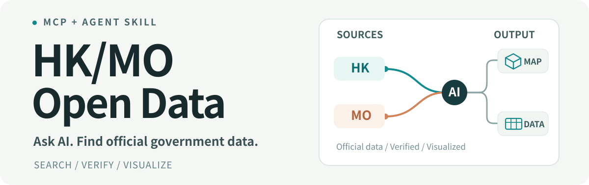

<p align="center">
  
</p>

<p align="center">
  <a href="#可以做甚麼">功能介紹</a> · <a href="#立即試試">使用例子</a> · <a href="#快速開始">快速開始</a> · <a href="#english">English</a>
</p>

**一句話，讓 AI 幫你使用香港與澳門政府公開數據。** 免費、開源，結合 MCP 與 Agent Skill，省去逐個網站尋找資料及研究使用方法的時間。

## 可以做甚麼

- **查找官方資料** — 查詢香港巴士到站、澳門停車場空位、天氣、人口等公開資料。
- **製作互動地圖** — 取得香港官方巴士路線彎線與道路形狀，或轉換澳門地圖檔案。
- **整理及應用資料** — 讀取常見資料格式，協助製作表格、圖表、網站及小工具。

資料會先核對官方來源；**找不到符合要求的資料，就直接說明，不用相似資料冒充。**

## 立即試試

> 幫我查澳門停車場的即時空位，並附上官方來源。

> 幫我取得香港 26 號巴士的行車路線，製作有彎線的互動地圖。

> 幫我取得香港道路形狀，製作中環附近的互動地圖。

## 快速開始

使用支援 MCP 和 Agent Skills、並可操作本機專案的 AI 助手，直接貼上：

```text
請幫我安裝並設定這個 MCP + Skill：
https://github.com/HiNesslio/hkmo-open-data-mcp

將它連接到我正在使用的 AI 工具，完成後確認可以正常使用。
```

<details>
<summary><strong>自行安裝（Node.js 20+）</strong></summary>

```bash
git clone https://github.com/HiNesslio/hkmo-open-data-mcp.git
cd hkmo-open-data-mcp
npm install
npm run build
```

將本機 `dist/src/index.js` 連接到支援 MCP 的 AI 工具，並載入 [Agent Skill](skill/SKILL.md)。澳門 Shapefile 轉換另需安裝 Python 相關套件。

</details>

> **使用須知：** 工具在你的電腦運行，不需要自行架設伺服器。部分政府資料可能需要手動下載，資料能否即時取得視乎官方服務。這是社群開源項目，並非政府官方產品。

---

<a id="english"></a>
## English

**Find and use Hong Kong & Macao government open data by asking your AI.** This free, open-source MCP server and Agent Skill help discover official datasets, read supported formats, and turn map data into interactive maps or images. Sources are verified; similar-looking datasets are not silently substituted.

**Get started:** Ask an AI coding assistant that supports local MCP and Skills to install and configure [this repository](https://github.com/HiNesslio/hkmo-open-data-mcp). For manual setup, use Node.js 20+, run `npm install && npm run build`, connect `dist/src/index.js` to your MCP client, and load [skill/SKILL.md](skill/SKILL.md). Some map conversions require Python.

[Publishing guide](docs/PUBLISHING.md) · [Security](SECURITY.md) · [Contributing](CONTRIBUTING.md) · [MIT License](LICENSE)
